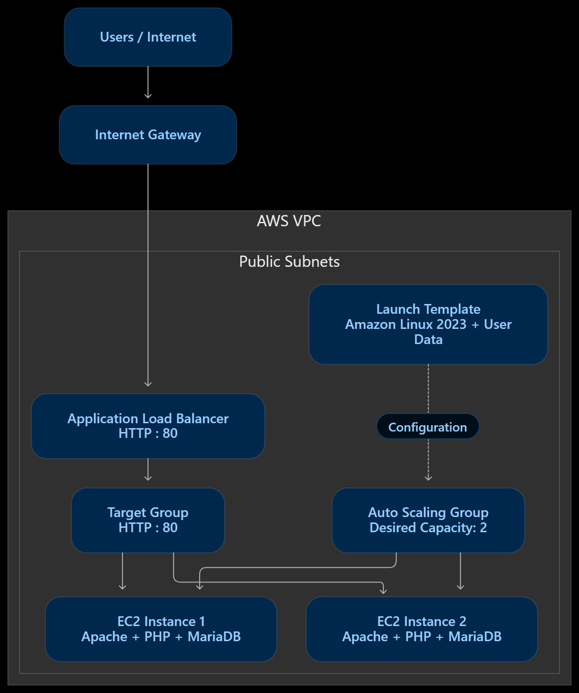

# Highly Available LAMP Stack on AWS

## Project Overview

Designed and deployed a highly available LAMP infrastructure on AWS using Amazon Linux 2023, EC2, Application Load Balancer and Auto Scaling Group.

The project demonstrates automated instance configuration, load balancing, network configuration and infrastructure health monitoring.

## Architecture Diagram

## Technologies Used

- Amazon Web Services (AWS)
- Amazon Linux 2023
- EC2
- Apache HTTP Server
- MariaDB
- PHP
- Application Load Balancer (ALB)
- Auto Scaling Group (ASG)
- Launch Templates
- VPC, Subnets and Internet Gateway
- Bash / EC2 User Data

## Architecture

1. Configured a VPC with public subnets and Internet Gateway routing.
2. Created an EC2 Launch Template with Amazon Linux 2023.
3. Used User Data to install and configure Apache, MariaDB and PHP.
4. Configured an Auto Scaling Group with a desired capacity of two instances.
5. Created a Target Group with HTTP health checks.
6. Configured an internet-facing Application Load Balancer to distribute HTTP traffic.

## Implementation Highlights

- Automated software installation using EC2 User Data.
- Configured network routing and security groups.
- Maintained two EC2 instances through Auto Scaling.
- Verified instance health through Target Group health checks.
- Tested application access through the ALB DNS endpoint.
- Troubleshot network routing and instance connectivity issues.

## Screenshots

See the `screenshots/` folder for deployment evidence.

## User Data Script

The EC2 initialization script is available in `user-data.sh`.

## Learning Outcomes

- AWS infrastructure deployment
- Linux server administration
- Network routing and connectivity
- Load balancing and auto scaling
- Infrastructure troubleshooting

## Note

This project uses a simple HTML test page to verify Apache availability. It is an infrastructure deployment exercise, not a complete production website.
